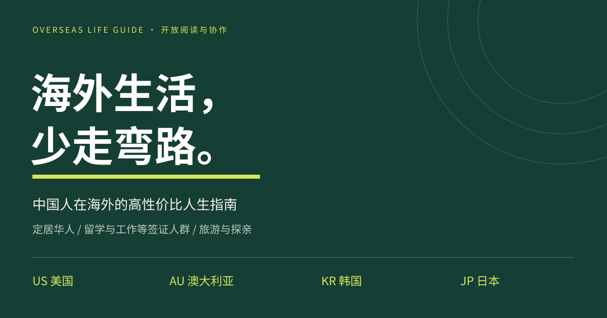

# 中国人在海外的高性价比人生指南

**美国 · 澳大利亚 · 韩国 · 日本**  
当地定居华人 · 留学与工作等签证人群 · 旅游与探亲人群

[打开阅读器](https://gerrygao1995-coder.github.io/overseas-life-guide/) · [身份与起步](START-HERE.md) · [参与共建](CONTRIBUTING.md) · [报告问题](https://github.com/gerrygao1995-coder/overseas-life-guide/issues)

先选国家，再选生活板块，从目录打开具体问题。完整保留四个原项目的 **164 个主题章节、1962 条建议**，新增 **24 册重点手册、527 个问答、177,597 个汉字**。新增内容优先解释签证、住房、工作、医保、税务与旅游的步骤、材料、费用演算、时间安排、案例和问题处理。

## 六个重点板块

| 国家 | 新增问答 | 手册 |
| --- | ---: | --- |
| 美国 | 124 | [签证](US-visa.md) · [住房](US-housing.md) · [工作](US-work.md) · [医保](US-health.md) · [税务](US-tax.md) · [旅游](US-travel.md) |
| 澳大利亚 | 140 | [签证](AU-visa.md) · [住房](AU-housing.md) · [工作](AU-work.md) · [医保](AU-health.md) · [税务](AU-tax.md) · [旅游](AU-travel.md) |
| 韩国 | 124 | [签证](KR-visa.md) · [住房](KR-housing.md) · [工作](KR-work.md) · [医保](KR-health.md) · [税务](KR-tax.md) · [旅游](KR-travel.md) |
| 日本 | 139 | [签证](JP-visa.md) · [住房](JP-housing.md) · [工作](JP-work.md) · [医保](JP-health.md) · [税务](JP-tax.md) · [旅游](JP-travel.md) |

新增手册按独立问答统计；汉字数量只统计新增手册内容。其他生活主题仍可在原有章节中阅读。

## 阅读方法

1. 打开阅读器，选择国家。
2. 选择签证与落地、医疗与健康、住房与搬家、工作与学习、钱税与退休、家庭照护、旅行安全、日常权益等板块。
3. 从章节目录进入问题。深度手册排在前面，原有章节同时保留。
4. 桌面使用左侧目录，手机使用板块、章节、条目下拉框；也可以用全文搜索直接查词。
5. 在正文中核对自己的身份条件。收藏保存在本机，可直接回到具体问题；复制链接可分享当前位置。

当地公民、中国籍永久居民、临时签证者、短期访客的路径分别说明。国籍、居留、工作授权、税务居民、医保和福利资格须分别核对。选择身份帮助阅读，不能代替机构对个人资格的判断。

“保存离线版”可下载包含全部正文的 `index.html`，打开即可离线搜索和阅读；外部来源需要联网。原来的章节与条目书签仍然可以访问。Github长篇Markdown可能省略显示，请使用阅读器或下载正文。

## 原有四国分卷

| 分卷 | 原有章节 | 原有条目 |
| --- | ---: | ---: |
| [美国](US.md) | 40 | 200 |
| [澳大利亚](AU.md) | 40 | 720 |
| [韩国](KR.md) | 36 | 274 |
| [日本](JP.md) | 48 | 768 |

原有分卷与新增手册独立维护，在网站中合并检索。具体收录与哈希记录在 [manifest.json](manifest.json)，导航和链接检查结果见 [reader-build-report.json](reader-build-report.json)。

## 来源与开放协作

以 Gerry 的 [美国](https://github.com/gerrygao1995-coder/the-american-life-playbook)、[澳大利亚](https://github.com/gerrygao1995-coder/live-better-australia)、[韩国](https://github.com/gerrygao1995-coder/better-life-korea)、[日本](https://github.com/gerrygao1995-coder/japan-life-playbook) 四个项目为底稿，按中国读者的身份和生活场景翻译、适配并扩写。原作署名见 [ATTRIBUTION.md](ATTRIBUTION.md)，翻译与核验范围见 [TRANSLATION.md](TRANSLATION.md)。

新增手册编辑于2026-10-09。政策和价格会变化，正文中的假设预算不是市场报价；应按地方、签证、家庭和保险条件查阅随文官方入口。没有宣称专业人士逐句审核全部内容或所有链接均可在同一天访问。

欢迎通过 Issue 和 Pull Request 修订，附国家、问题、适用身份、官方依据和日期。正文、翻译与改编 **CC BY 4.0**，阅读器与构建代码 **MIT**。请保留来源、署名和变更说明；第三方资料与商标保留其权利。

维护：编辑四国分卷或 `国家代码-主题.md`，运行 `python build_reader.py` 即可生成离线阅读页。无需安装依赖。改动正式条目时同步更新manifest。原始工作稿与署名资料见 `source-chapters.zip`。

其他独立版本：[日本人日文版](https://github.com/gerrygao1995-coder/japanese-overseas-life-guide) · [韩国人韩文版](https://github.com/gerrygao1995-coder/korean-overseas-life-guide)。两版分别排除日本和韩国。
